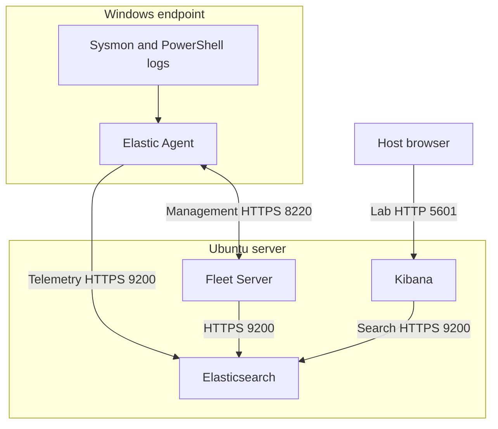

# ELK SOC Lab Deployment

A practical guide to building a two-VM security monitoring lab and tracing Windows telemetry from the endpoint to Kibana.

**Elasticsearch · Kibana · Fleet Server · Elastic Agent · Sysmon · PowerShell**

[Start the deployment guide](docs/deployment-guide.md) · [Download the Word guide](docs/ELK_SOC_Lab_Deployment_Guide.docx) · [Validation checklist](docs/validation-checklist.md)

## Lab architecture

Fleet Server manages agents. The Windows agent sends event data directly to Elasticsearch. Kibana provides the search interface. Logstash is not required for this design.

## Lab requirements

| Machine | Operating system | Suggested allocation |
| --- | --- | --- |
| Ubuntu server | Ubuntu Server 24.04 LTS x86_64 | 4 vCPU, 12 GB RAM, 80 GB disk |
| Windows endpoint | Windows 11 x64 | 2–4 vCPU, 4–8 GB RAM, 64 GB disk |
| Network | Shared private NAT network | Internet downloads and VM-to-VM connectivity |

These are suggested lab allocations. Allow memory for the host OS. The supplied commands and packages target x86_64 guests; Apple Silicon requires a compatible design.

## Deployment path

1. Prepare the VMs and record their addresses.
2. Install matching Elasticsearch and Kibana packages.
3. Validate Elasticsearch and enroll Kibana.
4. Configure the agent output and install Fleet Server.
5. Install Sysmon and enable PowerShell logging.
6. Enroll the Windows agent into its own policy.
7. Generate harmless events and find them in Discover.
8. Record results and repeat validation after reboot.

Follow the [complete guide](docs/deployment-guide.md) in order. Each stage includes commands and a checkpoint.

## What this project demonstrates

- Elastic Stack installation and service troubleshooting.
- Fleet policies, agent enrollment, and output trust configuration.
- Windows endpoint telemetry collection and KQL searches.
- Separation of agent management traffic from log ingestion.
- Evidence-based validation using Sysmon event 1 and PowerShell event 4104.

These are the learning objectives of the lab. Completed deployment and detection results must be supported by actual evidence.

## Validation and evidence

Use the [build record](docs/validation-checklist.md) to record real versions, test results, and remaining issues. Add your own redacted Fleet and Discover screenshots after deployment. No demonstration screenshots or successful results are fabricated here.

## Lab security boundaries

Use an isolated private network and restrict access to the required ports. The walkthrough uses HTTP for the Kibana browser and a self-signed Fleet certificate for Quick Start. Organizational deployments require approved TLS and access controls. Keep passwords, tokens, encryption keys, and sensitive event data out of commits and screenshots.

## Repository contents

| File | Purpose |
| --- | --- |
| [Deployment guide](docs/deployment-guide.md) | Full browser-readable walkthrough, commands, references, and troubleshooting |
| [Word guide](docs/ELK_SOC_Lab_Deployment_Guide.docx) | Downloadable standalone document |
| [Validation checklist](docs/validation-checklist.md) | Build record and evidence requirements |

## Acknowledgment

Adapted from the supplied ELK lab notes and the separately prepared standalone deployment guide. Vendor references are listed in the full guide. This repository documents a learning lab; it does not claim production readiness or completed attack detection coverage.
